# Дневник работы с ИИ

Записи по этапам: что попросили у ИИ (ключевой промпт), что получилось, где ИИ ошибся и как это исправили.
📸 — скриншоты, которые нужно снять для отчёта. Сами скриншоты лежат в [screenshots/](screenshots/).

---

## Этап 0. Разбор задания — 07.11.2026

**Инструмент:** Claude Code (Claude Opus 5.5).

**Промпт (суть):** отправили Claude полный текст положения номинации и переписку команды о распределении ролей. Попросили объяснить задание простыми словами и показать, где легко потерять баллы.

**Что получили:**
- Пересказ задания: за что дают баллы и как устроены 4 критерия.
- Главный вывод: красивый дизайн — это примерно четверть оценки. Ещё четверть приходится на документацию работы с ИИ, поэтому дневник нужно вести с первого дня.
- Список «ловушек»: подмена id в адресе, хранение паролей, плашка «концепт», запрет на логотип вуза, доступность сайта из России без VPN, тестовые аккаунты.
- Идеи, чтобы выделиться: кабинет сотрудника деканата (заявки меняют статус по-настоящему), главный экран «Что у меня сегодня», трекер заявки как у доставки, ИИ-помощник по правилам вуза.

**Где ИИ поправил человека:** в команде думали, что логотип обязателен. Claude уточнил, что запрещён только *официальный* логотип вуза, а свой логотип — по желанию, хотя он и повышает оценку за качество.

**Решили:** делаем кабинет для СВФУ (наш вуз). Название и логотип придумаем позже.

**Скриншоты:**

| Промпт с положением и начало ответа | Обязательное ядро и сценарий жюри | «Где легко потерять баллы» |
|---|---|---|
| 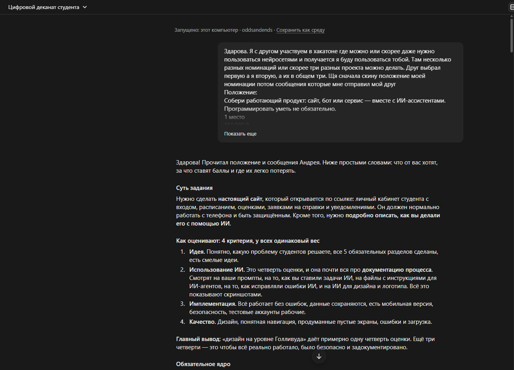 | 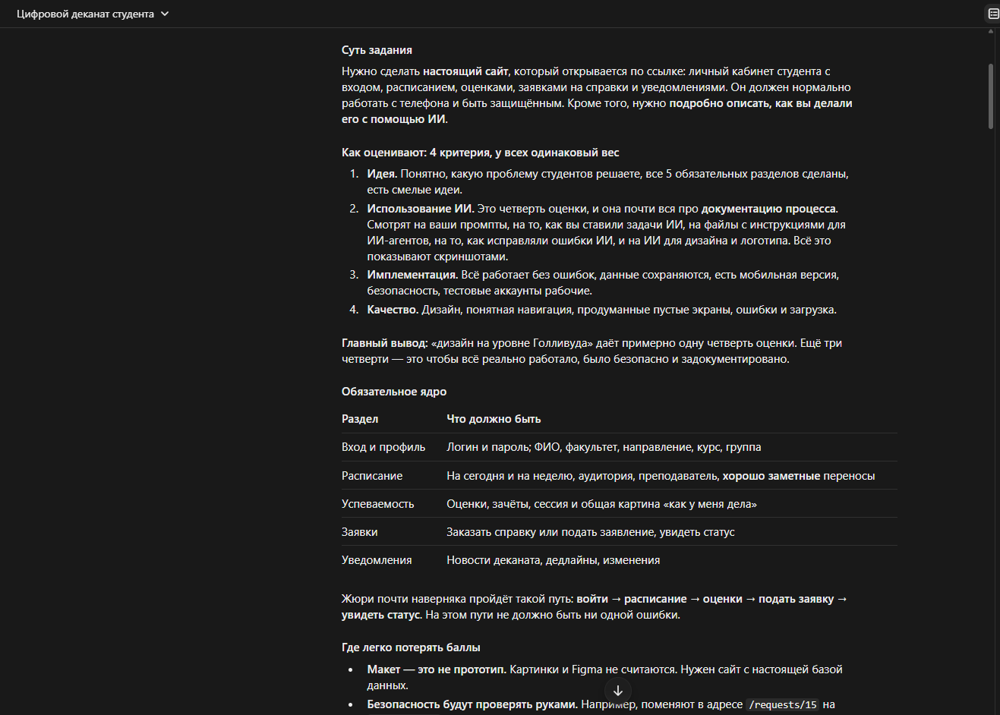 | 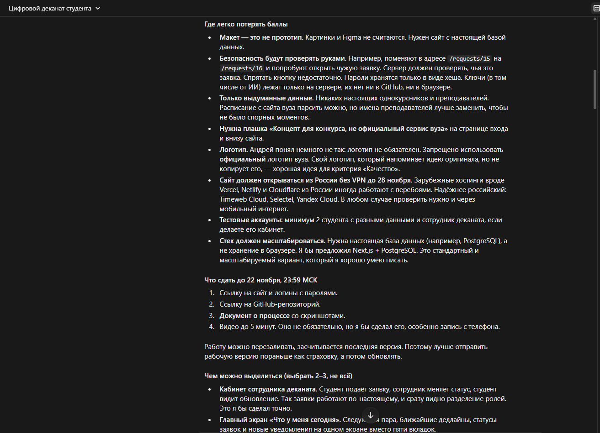 |

---

## Этап 1. Каркас проекта и файлы для ИИ — 08.11.2026

**Промпт (суть):** «Вуз — СВФУ в Якутске. Создай отдельную папку для проекта, проверь, что установлено, давай начнём».

**Что сделал ИИ:**
1. Проверил окружение: Node.js 24 есть, **Git не установлен** (нужно поставить вручную).
2. Создал проект командой `create-next-app` (Next.js 16.4, TypeScript, Tailwind CSS 4).
3. Написал документы для ИИ-агентов и для жюри:
   - `CLAUDE.md` — правила для ИИ: стек, безопасность, данные, интерфейс, порядок работы;
   - `docs/requirements.md` — положение конкурса в виде чек-листа;
   - `docs/decisions.md` — архитектурные решения с обоснованием;
   - `docs/licenses.md`, `docs/ai-process/tools.md`, этот дневник.

**Ошибка ИИ, которую поймали заранее:** установилась версия Next.js 16.4, а она новее того, на чём обучен ИИ. Шаблон проекта сам предупреждает об этом в `AGENTS.md`. Поэтому Claude сначала прочитал документацию, которая лежит внутри пакета (`node_modules/next/dist/docs/`), и нашёл отличия от привычного ему Next.js: `middleware` переименован в `proxy`, а `cacheComponents` включён по умолчанию и требует оборачивать чтение сессии в `<Suspense>`. Эти отличия записаны в `CLAUDE.md`, чтобы в следующих сессиях ИИ не писал код по устаревшим шаблонам.

**Проверка:** `npm run lint` и `npm run build` проходят без ошибок. `npm audit` нашёл 8 уязвимостей средней критичности. Все они в `minimatch` внутри линтера ESLint, то есть в инструменте разработки, а не в коде сайта. В продакшен этот код не попадает, поэтому принудительно обновлять пакеты (`npm audit fix --force` ломает совместимость) не стали. Вернёмся к этому перед сдачей.

**Вручную:** установка Git, создание репозитория на GitHub, первые коммиты.

**Скриншоты:**

| Промпт и ход работы агента: ИИ замечает, что Next.js новее его знаний | Итог этапа и инструкция по Git |
|---|---|
| 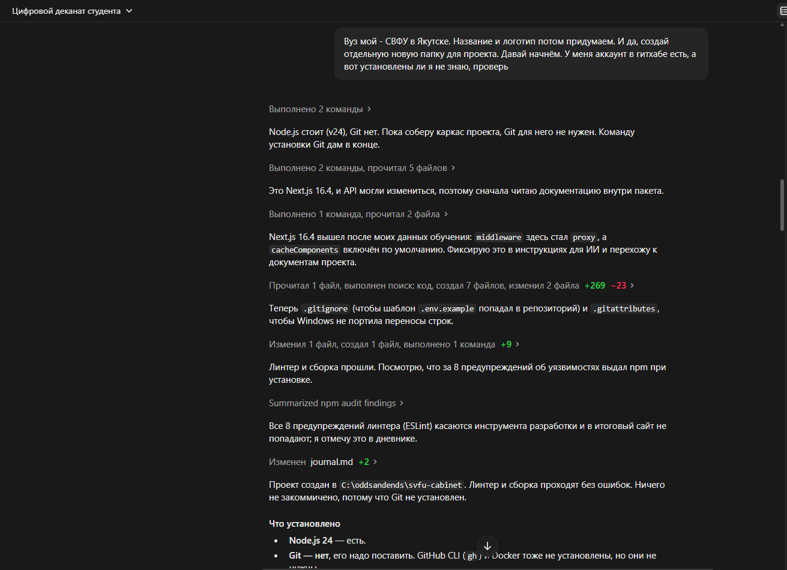 | 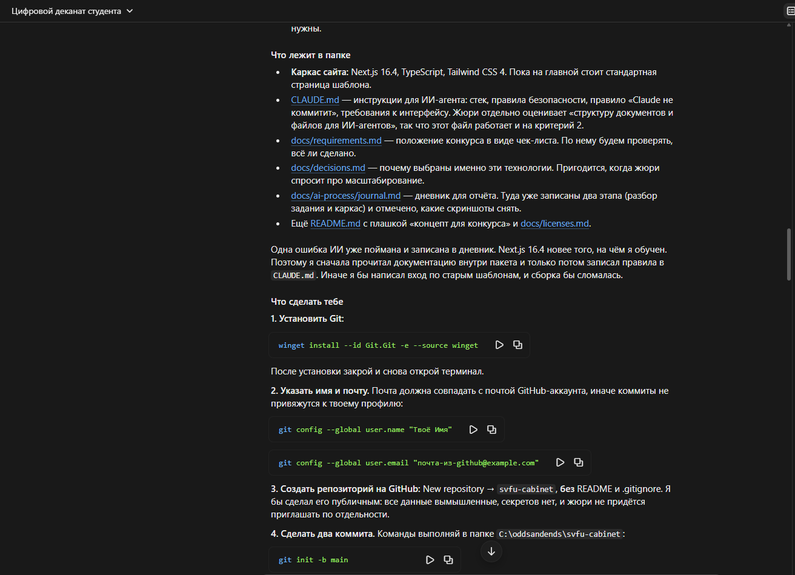 |

| Структура проекта и `CLAUDE.md` в VS Code | Репозиторий на GitHub после первых коммитов (ручной этап) |
|---|---|
| 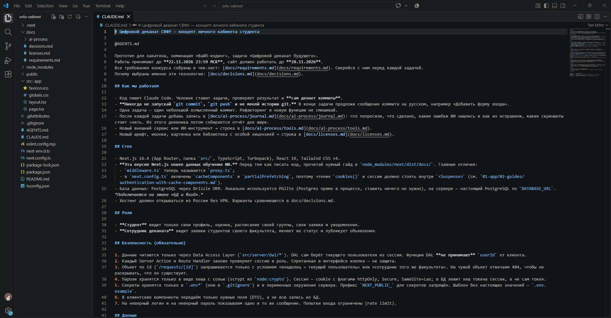 | 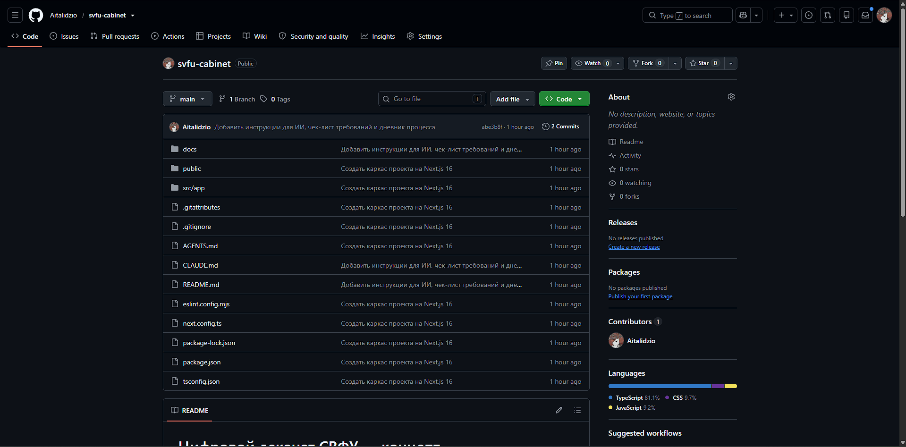 |

---

## Этап 2. Решения по продукту — 11–13.11.2026

**Как начался этап.** После каркаса ИИ предложил сразу делать базу данных и вход. Человек спросил: «Думаешь, с этого стоит начинать? Давай обсудим». В ответ ИИ пересмотрел план. База данных отражает то, что умеет кабинет: если строить её до решений о ролях, статусах заявок и системе оценок, таблицы придётся переделывать. Поэтому первым шагом стали решения без кода, а также поставлены пораньше деплой и «страховочная» отправка работы ([plan.md](../plan.md)).

**Промпт ИИ → человеку (суть):** четыре вопроса о том, как всё устроено в СВФУ: система оценок, какие справки нужны и как их получают, где смотрят расписание и объявления, какие фишки взять.

**Ответы человека** (это реальные порядки вуза, их ИИ знать не мог):
- Балльно-рейтинговая система до 100 баллов. Зачёт — от 60. Зачёт с оценкой: 55 / 65 / 85 → 3 / 4 / 5. Экзамен: допуск от 45, сам экзамен до 30 баллов, автомат «4» от 65 баллов по согласованию с преподавателем.
- Справки заказывают очно в деканате и забирают на следующий день.
- Расписание — неудобный Excel на сайте вуза. Удобный, но неофициальный Telegram-бот студентов. О переносах узнают от преподавателей.

**Что ИИ предлагал → что решил человек:**

| Предложение ИИ | Решение |
|---|---|
| Кабинет сотрудника деканата | ✅ Берём |
| Главный экран «Сегодня» | ✅ Берём |
| Трекер заявки «как у доставки» | ❌ Не нужен |
| ИИ-помощник по правилам вуза | ⏸ Позже, если останется время |
| Интерфейс на якутском | ✅ Берём, и человек **добавил английский** |
| Особый режим для морозных дней | ❌ Лишнее |
| Система уведомлений | ✅ Человек сам предложил: справка готова, изменения расписания |

**Что сделал ИИ:**
- Собрал всё в [product.md](../product.md): проблема «как сейчас», экраны студента и сотрудника, правила БРС в виде таблицы, каталог справок, языки, отклонённые идеи.
- Прочитал в документации Next.js 16.4, как устроена мультиязычность, и записал решение №6 в [decisions.md](../decisions.md): язык в адресе (`/ru`, `/sah`, `/en`).
- Обновил `CLAUDE.md`: запрет строк прямо в JSX (только словари трёх языков), требование к шрифту поддерживать якутские буквы Ҕ Ҥ Ө Һ Ү, смысл вместо голых баллов.
- Составил [опрос однокурсников](../research/survey.md) для проверки гипотез.

**Как ИИ работает с неизвестным:** то, чего ИИ не знает о порядках СВФУ, он не додумывает, а помечает ⚠️ в product.md. Например, считается ли итог экзамена по тем же порогам и есть ли отдельная справка для военкомата. В `CLAUDE.md` прописано правило: пункты с ⚠️ уточнять у команды.

**Своя ошибка ИИ:** решение №6 записал не в конец журнала решений, а перед №5. Заметил при проверке файла и переставил.

**Уточнения команды после этапа:** итог экзамена считается по сумме с теми же порогами, отдельного минимума на экзамене нет. Справку для военкомата отложили. Якутский перевод проверяет капитан команды.

**Скриншоты:**

| Ответы человека про БРС, справки, расписание | Предложенный ИИ порядок этапов |
|---|---|
| 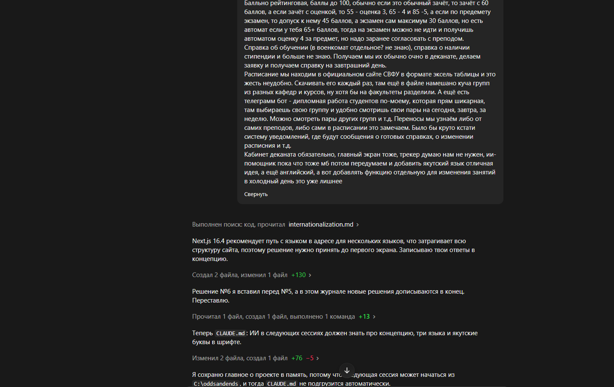 | 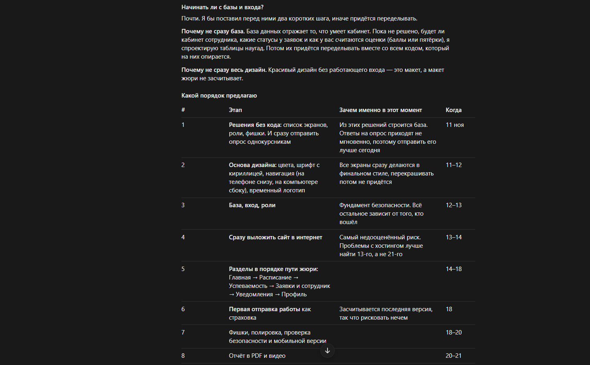 |

| Итог этапа | product.md: проблема и экраны | product.md: правила БРС и справки |
|---|---|---|
| 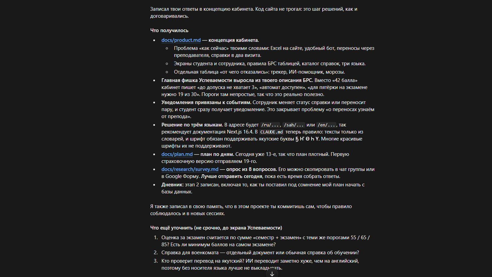 | 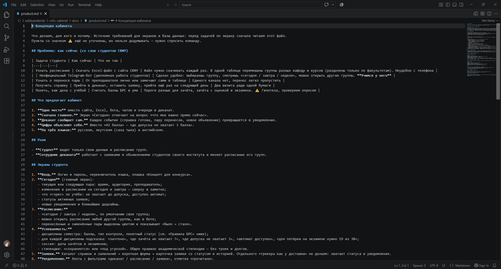 | 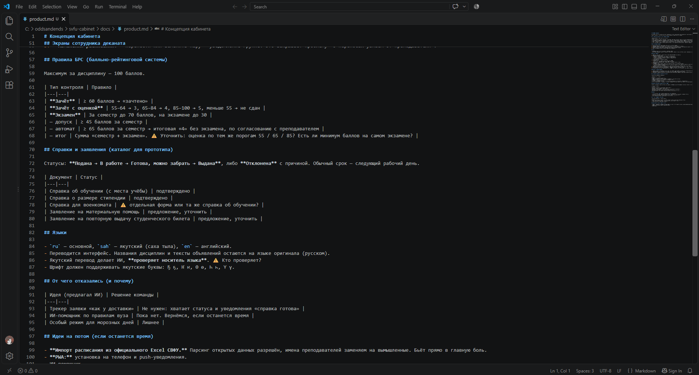 |

---

## Этап 3. Основа дизайна и три языка — 13.11.2026

**Промпт (суть):** ответы на оставшиеся вопросы (экзамен — по сумме баллов, справку для военкомата пока откладываем, якутский перевод проверяет капитан), затем: «Проверь скрины и коммиты, и да, начинаем».

**Что сделал ИИ:**
1. Проверил коммиты и скриншоты этапа 2, внёс уточнения в `product.md`.
2. **Прочитал документацию Next.js 16.4** про мультиязычность, `next/root-params` (появился только в 16.3), `proxy` и `global-not-found`. Выяснилось, что привычная настройка `dynamicParams` при включённых `cacheComponents` недоступна, поэтому неизвестный язык в адресе отсекается проверкой в коде и в `proxy.ts`.
3. **Проверил шрифты программно.** Скрипт на fontTools (`tools/check_sakha_fonts.py`) скачал 22 шрифта Google Fonts и прочитал их таблицы символов. Популярный Manrope не содержит Ҕ и Ҥ, а в Unbounded, Jost и Wix Madefor нет ни одной якутской буквы. Выбран Onest (решение №7 в [decisions.md](../decisions.md)).
4. **Проверил контраст палитры программно** (`tools/check_contrast.py`): 16 пар «текст / фон» в светлой и тёмной теме, все ≥ 4.5 : 1 (WCAG AA).
5. Сверстал:
   - адреса `/ru`, `/sah`, `/en`: адрес без языка перенаправляется по сохранённому выбору или по языку браузера;
   - навигацию: снизу на телефоне, сбоку на компьютере;
   - временный логотип-кристалл и иконку сайта;
   - страницу 404 на трёх языках;
   - заглушки разделов с продуманным «пустым» состоянием;
   - плашку «Концепт для конкурса» на каждой странице.
6. **Проверил в браузере** на 360 и 1280 px, в тёмной и светлой теме, на трёх языках:
   - нет горизонтальной прокрутки;
   - якутские буквы отображаются шрифтом Onest (набор `cyrillic-ext` действительно загружен);
   - переключатель языка запоминает выбор;
   - 404 отдаёт настоящий статус 404.

**Ошибки, которые поймали проверки:**

| Что пошло не так | Как нашли | Как исправили |
|---|---|---|
| На 360 px обрезались подписи вкладок: «Расписа…» (не хватало 6 px) и якутское «Сайаапк…» (12 px) | Скриншот в браузере, затем скрипт замерил ширину каждой подписи на трёх языках | Убрали лишние отступы панели, для якутского добавили короткую подпись «Сайаапка» (на проверку носителю). Повторный замер: всё помещается |
| Python-скрипт проверки шрифтов упал при выводе якутских букв в консоль Windows (кодировка cp1251) | Ошибка `UnicodeEncodeError` | Скрипт выводит коды символов (U+0494) вместо самих букв |
| Файл запуска dev-сервера для встроенного браузера положен в папку проекта, а приложение ищет его в корне сессии | Сообщение об ошибке инструмента | Перенесён в `C:\oddsandends\.claude\launch.json`, вне репозитория |
| В `proxy.ts` написано выражение `x as T ?? y` с неочевидным приоритетом операторов | Самопроверка кода перед сборкой | Переписано на простой цикл |

**Якутский перевод:** ИИ перевёл навигацию и заголовки, а длинные тексты пока оставил на русском. Список строк на проверку с сомнениями ИИ — в [i18n-todo.md](../i18n-todo.md).

**Скриншоты (сняты ИИ во время проверки в браузере):**

| Телефон, тёмная тема, EN | До исправления: подписи обрезаны (САХ) | После исправления (RU) | Компьютер, светлая тема |
|---|---|---|---|
| 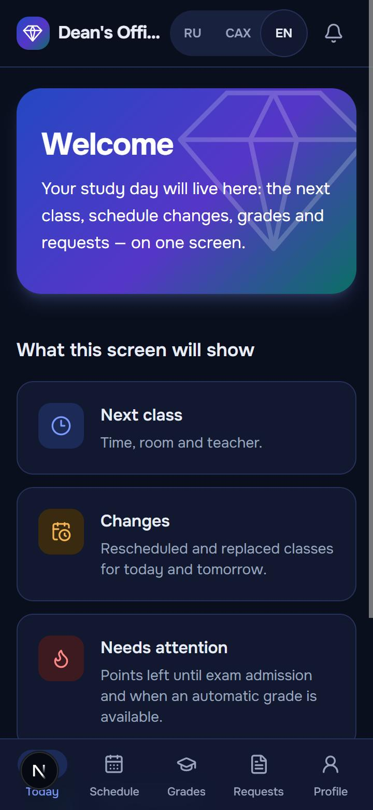 | 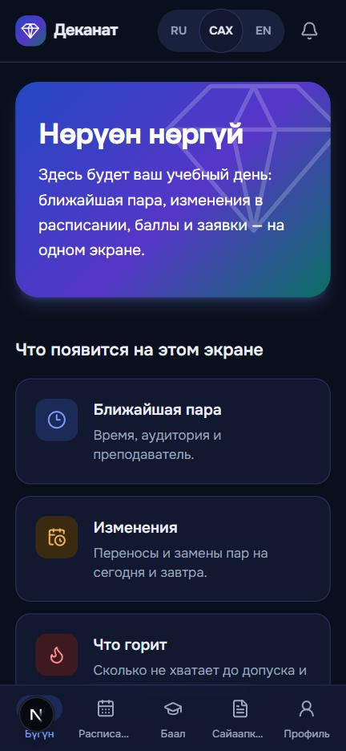 | 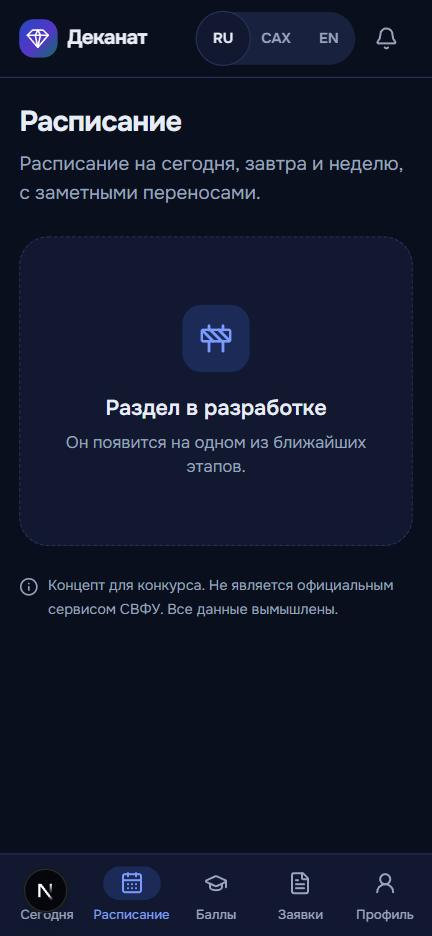 | 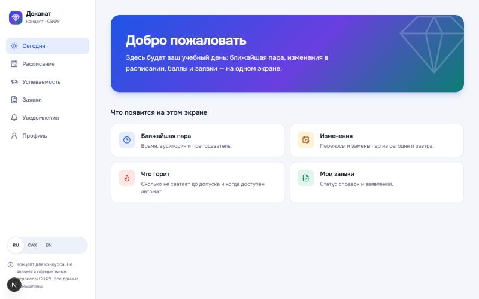 |

**Скриншоты диалога (снял человек):**

| Промпт и начало работы: проверка шрифтов скриптом | Поиск обрезанных подписей и замер ширины | Итог этапа |
|---|---|---|
| 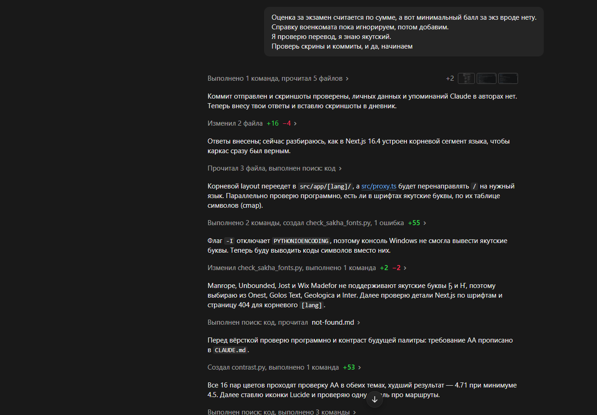 | 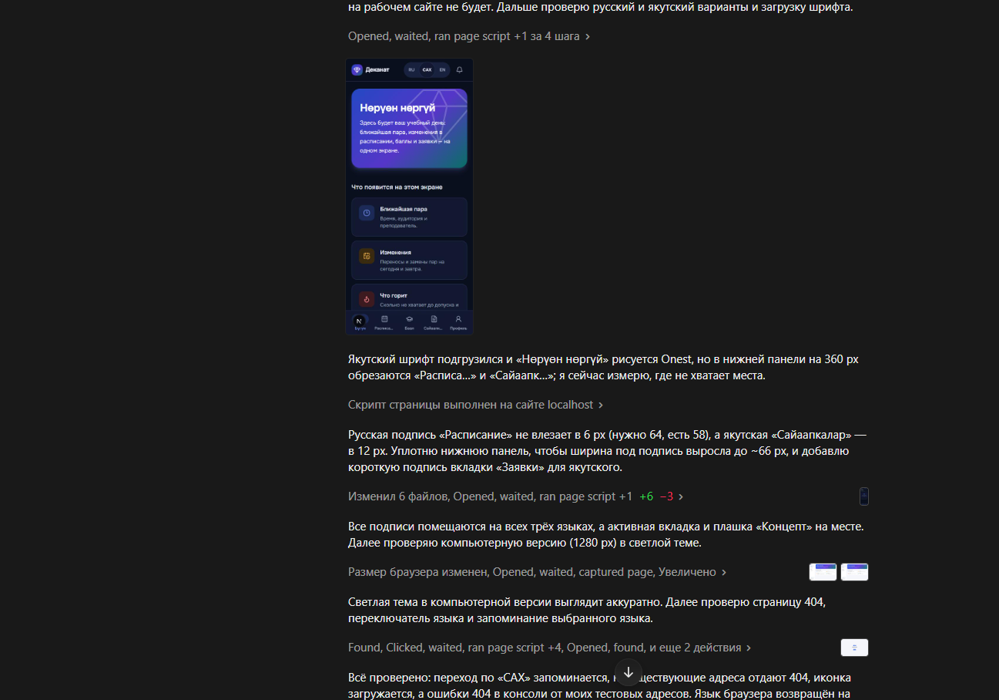 | 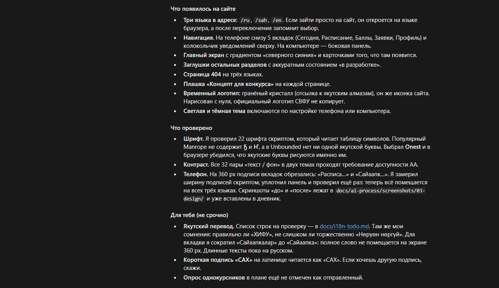 |

---

## Этап 4. База данных и вход — 13.11.2026

**Промпт (суть):** «Проверь скрины и коммиты и начинай».

**Что сделал ИИ:**
1. Проверил коммиты и скриншоты этапа 3.
2. **Прочитал в документации Next.js 16.4** гайды про аутентификацию (сессии в базе, слой доступа к данным, Server Actions, проверки в `proxy.ts`) и про `connection()` / `io()`.
3. **Проверил актуальные версии библиотек** перед установкой. Drizzle ORM 1.0 пока в стадии release candidate, поэтому взята стабильная 0.45.4.
4. Подключил базу: PostgreSQL на сервере, PGlite локально (решения №2 и №8 в [decisions.md](../decisions.md)). Описал схему (институты, группы, пользователи, сессии, попытки входа) и сгенерировал SQL-миграцию.
5. Написал `npm run db:setup`: миграции и вымышленные демо-аккаунты (3 студента из двух институтов и сотрудник деканата). Пароль берётся из `.env.local`, в коде паролей нет.
6. Сделал вход:
   - хеширование паролей scrypt с солью;
   - сессии с httpOnly-cookie, в базе хеш токена;
   - одинаковое сообщение для неверного логина и неверного пароля (с одинаковым временем ответа);
   - ограничение попыток;
   - «Выйти» и «Выйти на всех устройствах»;
   - проверку в два слоя (`proxy.ts` + слой доступа к данным).
7. Сверстал страницу входа (телефон и компьютер), профиль с данными из базы и приветствие по имени на главной.
8. Написал [security.md](../security.md): как устроены вход и защита, простыми словами для жюри.

**Проверка в браузере и в базе:**

| Что проверили | Результат |
|---|---|
| `/ru/profile` без входа | перенаправление на `/ru/login` |
| Неверный пароль и несуществующий логин | одно и то же сообщение, логин остаётся в поле |
| Вход `s.nikolaeva` | «Добро пожаловать, Сардаана», в профиле её данные |
| Вход `a.egorov` (на английском) | только его данные: ФТИ, Ф-25-2; Сардааны на странице нет |
| Вход `dekanat.imi` | роль «Сотрудник деканата», без группы и зачётки |
| Страница входа, когда уже вошёл | сразу ведёт в кабинет |
| 6 неудачных попыток подряд | после 5-й «Слишком много попыток» |
| `document.cookie` после входа | cookie сессии не видна JavaScript |
| Копия базы: таблица `users` | только хеши `scrypt$…`, открытых паролей 0 |
| Таблица `sessions` после «Выйти на всех устройствах» | пусто |

**Ошибки, которые поймали проверки:**

| Что пошло не так | Как нашли | Как исправили |
|---|---|---|
| **У всех демо-пользователей была одинаковая соль пароля**: скрипт посчитал хеш один раз и раздал всем. Одинаковые пароли давали одинаковые хеши | ИИ открыл копию базы и сравнил хеши | Отдельный хеш на каждого пользователя. Пересоздали базу, проверили: 4 разные соли из 4 |
| Лимит «20 неудач с одного IP» при неизвестном IP превращался в общий лимит на всех: один злоумышленник мог бы заблокировать вход всем | Самопроверка кода во время теста ограничения попыток | Лимит по IP действует только при известном IP |
| Next.js: «встретил `Date.now()` при пререндеринге» на главной и в профиле | Индикатор «1 Issue» в браузере и лог сервера | Скрипт показал, что библиотеки не вызывают `Date.now()` при импорте. Причина: PGlite считает SQL `now()` по часам JavaScript. По документации 16.3+ добавили `await io()` в `db()` |
| `@next/env` не имеет экспорта по умолчанию, скрипт упал | Ошибка при запуске `db:setup` | Именованный импорт `loadEnvConfig` |
| PGlite не создаёт вложенные папки | Ошибка `ENOENT mkdir .data\pglite` | Папка создаётся заранее |
| Казалось, что профиль «не догружается» (скелетон в DOM при готовом HTML) | Сравнили HTML с сервера и DOM в браузере | Не баг: панель браузера была скрыта, а React 19 показывает потоковые блоки по кадрам анимации. Скриншот «разбудил» кадр, и данные появились |

**Скриншоты (сняты ИИ во время проверки):**

| Вход на телефоне | Ошибка входа | Блокировка после 5 попыток |
|---|---|---|
| 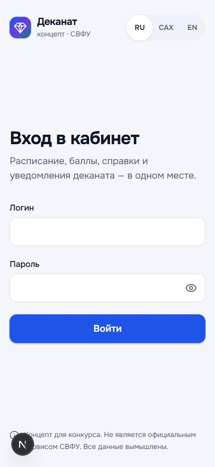 | 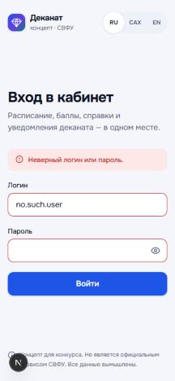 | 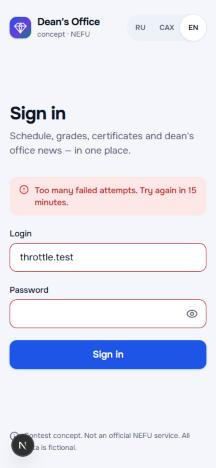 |

| Студентка 1 (виден индикатор «1 Issue» до исправления) | Студент 2 видит только себя (EN) |
|---|---|
| 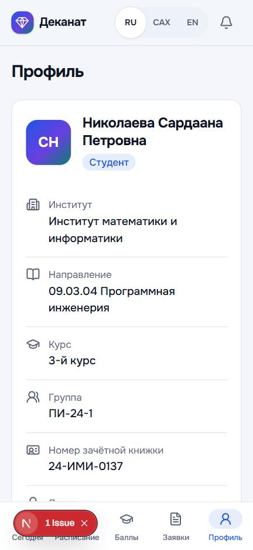 | 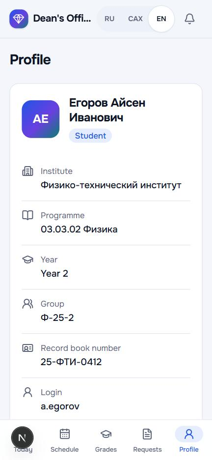 |

| Вход на компьютере, тёмная тема | Профиль сотрудника деканата |
|---|---|
| 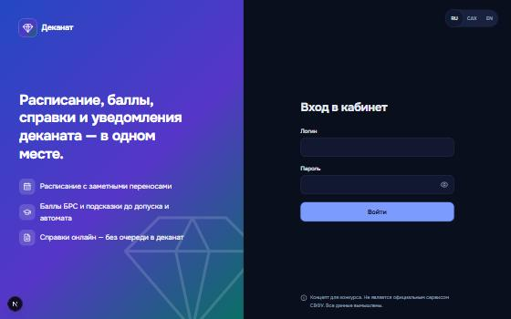 | 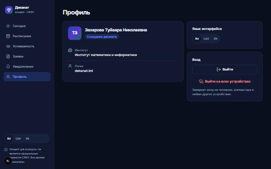 |

**Скриншоты диалога (снял человек):**

| Промпт и начало этапа: документация, выбор версий | ИИ находит ошибки (IP-лимит, одинаковая соль) | Итог этапа |
|---|---|---|
| 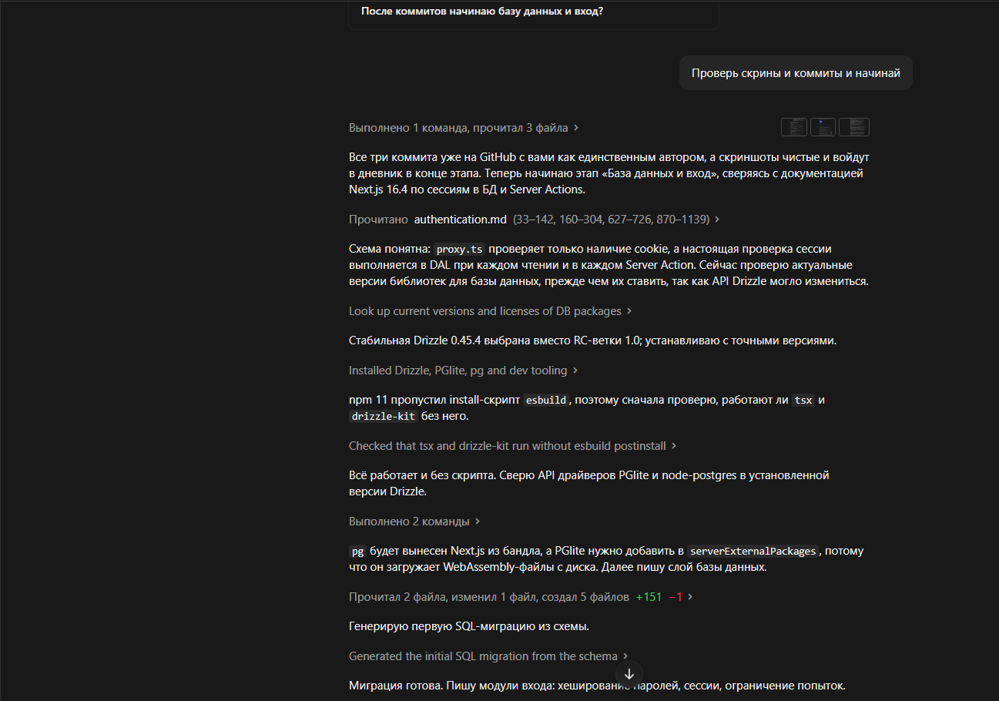 | 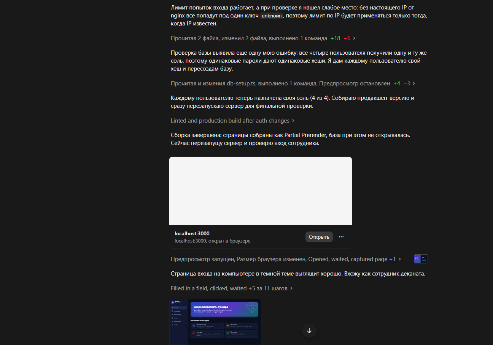 | 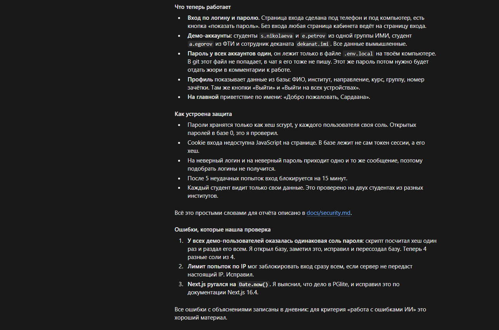 |

---

## Этап 5. Расписание — 13.11.2026

**Промпт (суть):** «Проверь скрины и коммиты. А выкладывать сайт вообще обязательно по условию? Если да, то давай сделаем это чуть попозже, доделаем сам сайт».

**Решение по выкладке:** ИИ нашёл в положении ответ «да, обязательно» («Кабинет открывается по ссылке в браузере», «Прототип открывается из России без VPN и работает до 28 ноября»). По решению команды выкладка перенесена на 18.11, план обновлён.

**Что сделал ИИ:**
1. Проверил коммиты этапа 4 и всю историю git: `.env.local`, база и демо-пароль ни в один коммит не попали. Скриншоты проверил на наличие пароля.
2. Решил начать экраны с расписания: главный экран «Сегодня» собирается из расписания, баллов и заявок, поэтому его логично делать последним.
3. Спроектировал модель «регулярные пары + изменения на даты» (решение №9) и сгенерировал миграцию.
4. Написал модуль календаря со временем по Якутску и проверил его 11 тестами, включая случай, когда в UTC ещё 13-е, а в Якутске уже 14-е.
5. Проверил, что Node.js умеет якутские названия дней и месяцев («Сэтинньи 16, бэнидиэнньик»). Значит, на `/sah` даты переводятся автоматически.
6. Добавил демо-расписание двух групп (16 вымышленных преподавателей, 31 пара) и 21 изменение на 7 недель. `db:setup` теперь заполняет каждый раздел отдельно и не трогает уже существующие аккаунты.
7. Сверстал страницу:
   - вкладки «Сегодня / Завтра / Неделя»;
   - листание недель, отметка чётной и нечётной недели;
   - выбор группы (ссылку на расписание чужой группы можно отправить);
   - карточки пар с «было → стало», «Идёт сейчас» и пустыми днями.

**Проверка в браузере:**

| Что проверили | Результат |
|---|---|
| Студентка, вкладка «Сегодня» (пт, 13 ноября, 12:56 по Якутску) | 3 пары, третья (11:40–13:15) с отметкой «Идёт сейчас» |
| Сотрудник деканата (без своей группы) | открывается первая группа института, без плашки «чужая группа» |
| Выбор группы Ф-25-2 | адрес `?group=Ф-25-2`, плашка «Вы смотрите расписание группы Ф-25-2 · Вернуться к своей» |
| Неделя 9–14 ноября | замена преподавателя и перенос с четверга на субботу видны с обеих сторон |
| Якутский язык, компьютер, тёмная тема | даты по-якутски, буква Ҥ отображается шрифтом Onest |
| Мусор в адресе: `?group=XXX`, `?week=not-a-date`, `?group=' OR 1=1 --` | своя группа и текущая неделя, без ошибок |
| Ширина 360 px | без горизонтальной прокрутки |

**Ошибка, найденная при проверке:** для аудиторий-названий выходило «ауд. Актовый зал» и «ауд. Спортзал». Исправлено: «ауд.» ставится только перед номером.

**Вопросы к команде (⚠️ в product.md):** время пар в СВФУ, есть ли чередование недель, как обозначают корпуса.

**Скриншоты (сняты ИИ во время проверки):**

| «Сегодня», идёт 3-я пара | Неделя с изменениями (вид сотрудника) | Расписание другой группы |
|---|---|---|
| 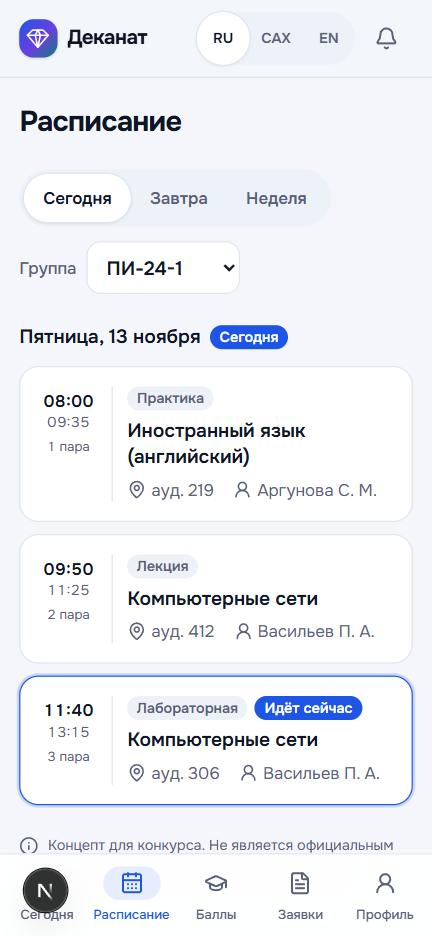 | 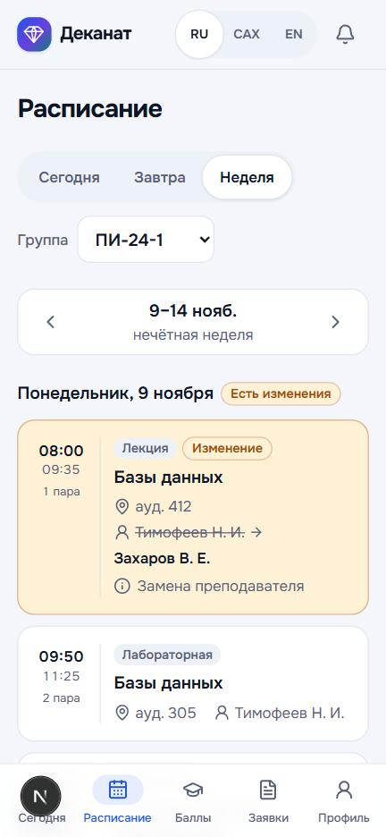 | 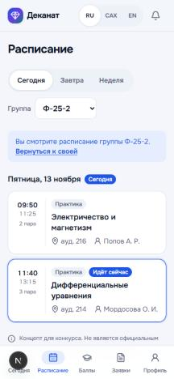 |

| Компьютер, якутский язык, тёмная тема |
|---|
| 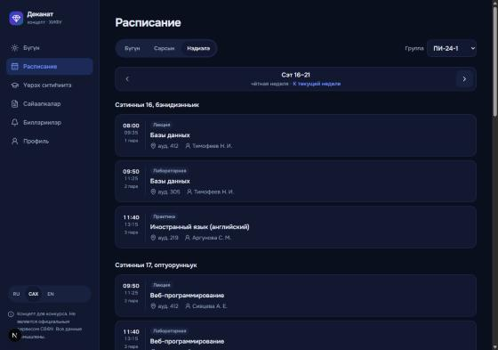 |

**Скриншоты диалога (снял человек):**

| Промпт и начало этапа | Проверка в браузере | Итог этапа |
|---|---|---|
| 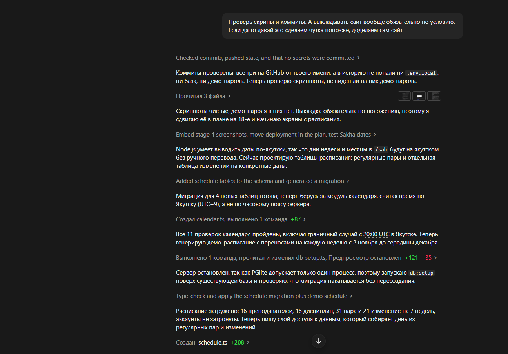 | 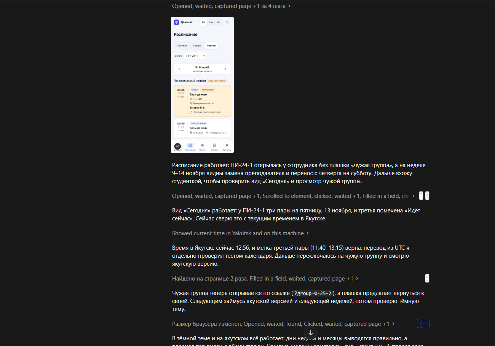 | 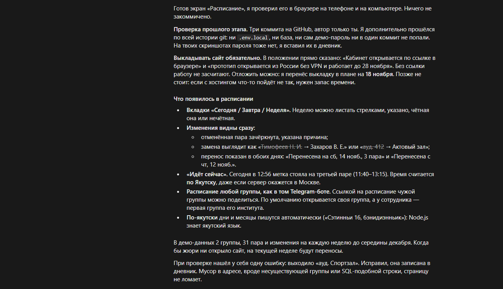 |

---

## Этап 6. Успеваемость — 13.11.2026

**Промпт (суть):** «Давай, теперь успеваемость».

**Что сделал ИИ:**
1. Проверил коммиты и скриншоты этапа 5 (демо-пароля нет ни в истории, ни на скриншотах).
2. **Сначала правила, потом экран.** Вынес правила БРС в отдельный модуль `src/lib/brs.ts` и покрыл тестами, включая пример из концепции: 66 баллов → автомат «4», для «5» на экзамене нужно 19 из 30. Перевёл и прошлые проверки календаря в постоянные тесты, добавил `npm test` — всего 31 тест.
3. Спроектировал таблицы: дисциплины семестра → запланированные контрольные → баллы студента, плюс зачётная книжка (решение №10).
4. Сделал демо-данные для трёх разных ситуаций:
   - Сардаана — сильная студентка: автомат по ОС, но нужно подтянуть теорию вероятностей;
   - Эрхан — в той же группе, но с «опасными» дисциплинами и без стипендии;
   - Айсен — другой институт и другие предметы.

   Баллы раскладываются по контрольным так, что разбивка всегда точно сходится с итогом.
5. Сверстал экран:
   - сводка «Как дела с учёбой»: сколько дисциплин по плану, что требует внимания, стипендия, даты сессии;
   - карточки дисциплин со шкалой (набрано / ещё можно набрать / пороги) и подсказкой человеческим языком, разбивка «Из чего баллы»;
   - список сессии и зачётная книжка со средним баллом.

**Ошибки ИИ, которые нашли и исправили:**

| Что пошло не так | Как нашли | Как исправили |
|---|---|---|
| Первая версия правил оценивала текущие баллы «как будто семестр закончен»: в середине семестра почти у всех вышла бы «3» и «стипендия под угрозой» | ИИ заметил, подбирая демо-данные: у зачёта с оценкой к ноябрю физически можно набрать максимум 60 из 100 | Уровень тревоги теперь учитывает, сколько баллов ещё впереди (функция `effort`), тесты переписаны: 30 → 31 |
| Подсказка «Сейчас выходит «2» (неудовлетворительно)» в середине семестра пугала и была неверной по сути | Скриншот карточки на телефоне | Ниже «4» подсказка считает от цели: «До «4» не хватает 24 балла, до «3» — 14» |
| Инициалы переносились на разные строки («Охлопков Д. / С.») | Тот же скриншот | Неразрывные пробелы в `shortName`, это заодно исправило и расписание |
| Тип словаря требовал у английского и якутского все 4 формы множественного числа, как у русского | Проверка типов (`tsc`) | Во всех словарях заполнены все 4 ключа: проверка «одинаковые ключи во всех языках» сохранена |
| В блоке «Сессия» было вписано «ауд.» по-русски, на английском было бы неверно | Самопроверка | Переиспользована функция `roomLabel` из расписания |
| Инструменты записали в код невидимый неразрывный пробел, а попытка исправить через `sed` превратила его в `join("00A0")` | Просмотр байтов файла (`od -c`) и проверочный запуск | Именованная константа `NBSP = String.fromCharCode(0xa0)` |

**Проверка в браузере:**

| Что проверили | Результат |
|---|---|
| Сардаана, телефон | 7 из 9 по плану; внимание — «Проектирование ПО» и «Теория вероятностей»; стипендия назначена; сессия с 18 декабря |
| Склонение | «17 баллов», «2 балла», «31 балл» |
| «Из чего баллы» | 7 + 14 + 7 = 28 — ровно итог, будущие контрольные помечены «впереди» |
| Эрхан (та же группа) | только свои баллы; «Теория вероятностей» красная: «Плановых баллов не хватит»; стипендия не назначена |
| Сотрудник деканата | понятное пустое состояние вместо ошибки |
| Компьютер, тёмная тема | две колонки карточек, зачётная книжка со средним баллом |

**Скриншоты (сняты ИИ во время проверки):**

| Сводка (телефон) | До исправления формулировки | После исправления |
|---|---|---|
| 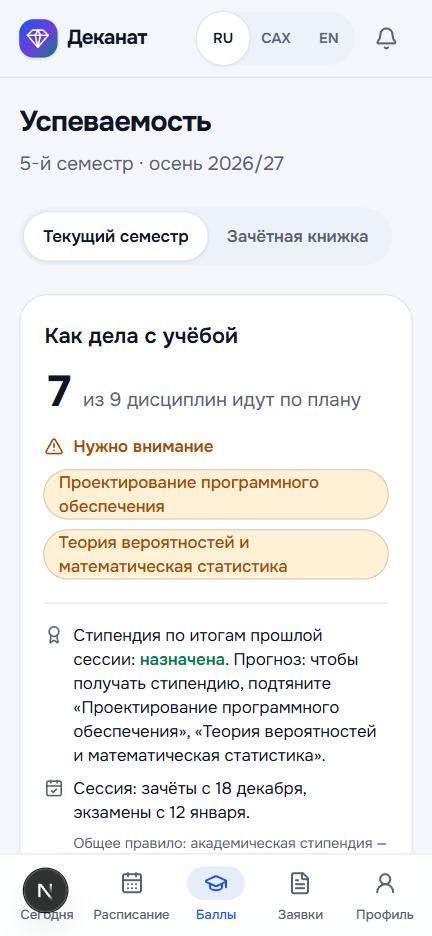 | 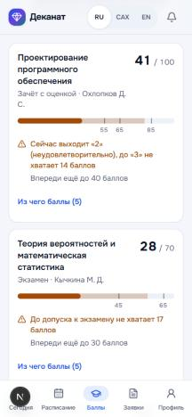 | 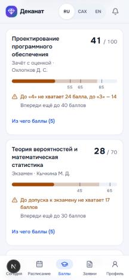 |

| Из чего баллы | Семестр на компьютере | Зачётная книжка |
|---|---|---|
| 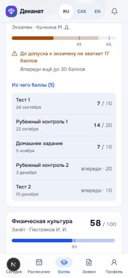 | 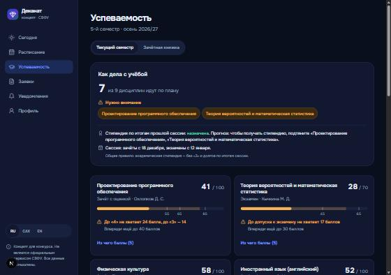 | 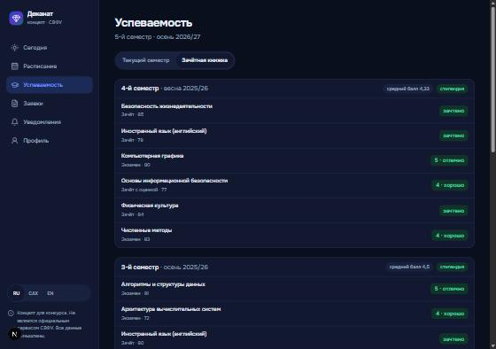 |

| Другой студент той же группы видит только свои баллы | Вид сотрудника деканата |
|---|---|
| 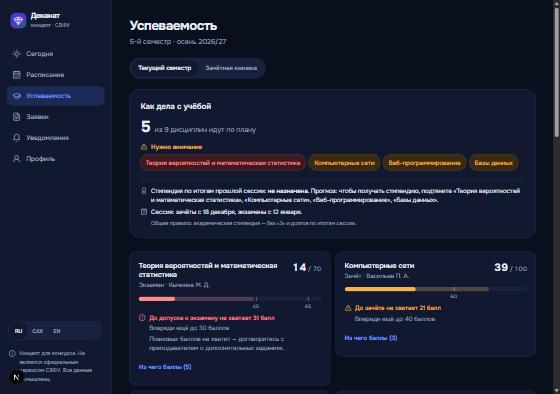 | 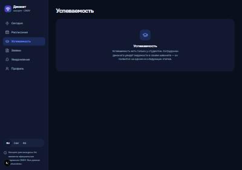 |

📸 Снять человеку: промпт этапа · момент, где ИИ замечает, что правила пугают «тройкой» в середине семестра · результат `npm test`.
